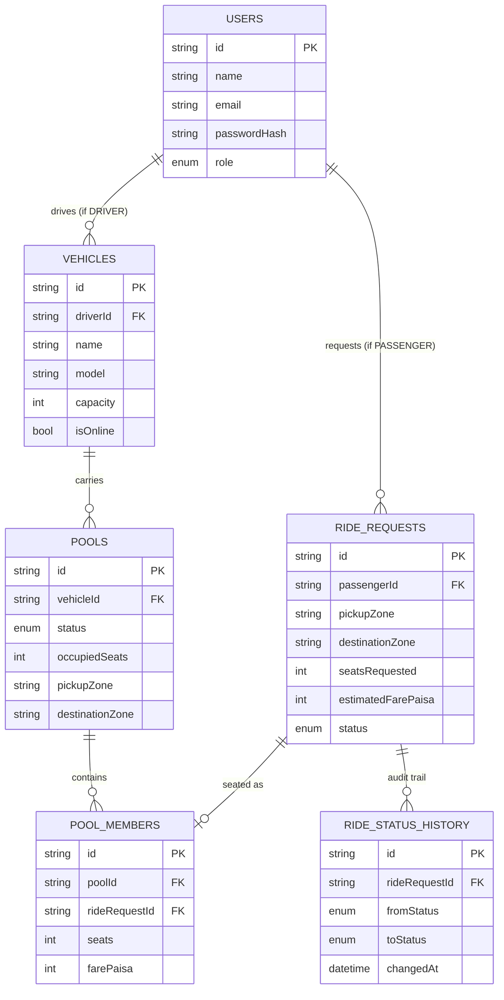

# Dhaka Pool 🚗

A ride-pooling demo app for Dhaka — passengers request rides, a driver
pools compatible passengers into one vehicle up to its seat capacity,
and the whole trip lifecycle is tracked from request to completion.

## 1. Project summary

Dhaka Pool is a small but complete Uber-Pool-style system built to
demonstrate correct handling of the two hardest parts of ride pooling:
**route-compatible matching** and **concurrency-safe seat allocation**.
It ships as a Dockerized full-stack app: a Next.js frontend, an
Express/Prisma/PostgreSQL API, and seed data starring the exact people
from the assignment brief (Jashim and his Tesla "Bullet", plus
passengers Nusrat, Rafiq, and Shirin).

## 2. Problem statement

Build a simplified ride-pooling platform where:
- Passengers can sign up, request a ride between predefined Dhaka
  zones, and track its status.
- A driver with a fixed-capacity vehicle can see compatible ride
  requests, accept them into a shared pool, and run the trip through
  its lifecycle.
- The system must **never** let a vehicle's occupied seats exceed its
  capacity — even if two passengers claim the last seat at the exact
  same moment.

## 3. Features

**Passenger**
- Sign up / sign in (JWT)
- Select pickup, destination, and seat count from predefined zones
- See an estimated fare before requesting
- Request a ride, see live status (REQUESTED → ACCEPTED →
  DRIVER_ARRIVED → STARTED → COMPLETED / CANCELLED)
- Cancel a ride while it's still in a cancellable state
- View ride history

**Driver (Jashim / Tesla Bullet, 3 seats)**
- Sign in, go online/offline
- See only the ride requests that are route-compatible with the
  vehicle's current pool and that fit in the remaining seats
- Accept a request (concurrency-safe seat allocation)
- Mark driver arrived → start trip → complete trip (moves every
  passenger in the pool together)
- View trip history

**Pooling engine**
- Deterministic, explainable compatibility rule (zone clusters)
- Hard seat-capacity enforcement, protected against race conditions
- Integer-paisa fare calculation with a per-seat pooling discount

## 4. Screenshots

This is a code deliverable without a hosted deployment (see
[§18 Deployment](#18-deployment)), so no screenshots are included.
Run `docker compose up` and open `http://localhost:3000` to see it live.

## 5. Architecture diagram

```mermaid
flowchart TD
    Browser[Browser] --> Frontend[Next.js Frontend]
    Frontend -->|REST + JWT| API[Express API]
    API --> Prisma[Prisma Client]
    Prisma --> DB[(PostgreSQL)]
    API -. row lock via SELECT ... FOR UPDATE .-> DB
```

```
┌──────────────┐
│   Browser    │
└──────┬───────┘
       ↓
┌──────────────┐
│   Next.js    │
│   Frontend   │
└──────┬───────┘
       ↓  REST + JWT
┌──────────────┐
│ Node.js API  │
│   Express    │
└──────┬───────┘
       ↓  Prisma
┌──────────────┐
│ PostgreSQL   │
└──────────────┘
```

## 6. ERD



## 7. Tech stack

| Layer      | Choice                                   |
|------------|-------------------------------------------|
| Frontend   | Next.js 14 (App Router), plain fetch, no CSS framework |
| Backend    | Node.js, Express                           |
| ORM        | Prisma                                     |
| Database   | PostgreSQL 16                              |
| Auth       | JWT (jsonwebtoken) + bcrypt password hashing |
| Testing    | Jest + Supertest                           |
| Container  | Docker, Docker Compose                     |

## 8. Project structure

```
dhaka-pool/
├── docker-compose.yml
├── .env.example
├── backend/
│   ├── prisma/
│   │   ├── schema.prisma
│   │   ├── seed.js
│   │   └── migrations/20260101000000_init/migration.sql
│   ├── src/
│   │   ├── app.js, index.js
│   │   ├── db/prisma.js
│   │   ├── middleware/ (auth.js, errorHandler.js)
│   │   ├── routes/ (auth, ride, driver)
│   │   ├── services/ (location, fare, matching)
│   │   └── utils/stateMachine.js
│   ├── tests/ (fare, state, matching, pool, ownership, cancellation)
│   └── Dockerfile
└── frontend/
    ├── src/app/ (login, passenger/*, driver/*)
    ├── src/lib/api.js
    └── Dockerfile
```

## 9. Prerequisites

- Docker and Docker Compose (recommended — no local Node/Postgres needed)
- OR: Node.js 20+, PostgreSQL 16, and `npm` if running services natively

## 10. Environment variables

Copy `.env.example` to `.env` at the repo root before running Compose:

| Variable | Where | Meaning |
|---|---|---|
| `DATABASE_URL` | backend | Postgres connection string |
| `JWT_SECRET` | backend | Secret used to sign auth tokens |
| `PORT` | backend | API port (default 4000) |
| `NEXT_PUBLIC_API_BASE` | frontend | URL the browser calls for the API |

## 11. Docker setup

```bash
git clone <this-repo>
cd dhaka-pool
cp .env.example .env
docker compose up --build
```

- API: http://localhost:4000
- Frontend: http://localhost:3000
- Postgres: localhost:5432 (user/pass: `postgres`/`postgres`, db: `dhaka_pool`)

The API container automatically runs `prisma migrate deploy` and the
seed script on every boot before starting the server.

## 12. Database migration

Migrations live in `backend/prisma/migrations/`. To run them manually
against a database you're already connected to:

```bash
cd backend
npx prisma migrate deploy
```

The initial migration also creates a Postgres trigger,
`enforce_pool_capacity`, that re-checks `occupiedSeats <= capacity` on
every write to `pools` as a defense-in-depth backstop (see §16 Design
decisions).

## 13. Seed instructions

```bash
cd backend
npm run seed
```

This creates Jashim (driver, Tesla Bullet, capacity 3) and passengers
Nusrat, Rafiq, and Shirin. Safe to re-run (upserts by email).

## 14. Demo credentials

All demo accounts share the password `password123`.

| Name | Email | Role |
|---|---|---|
| Jashim | jashim@dhakapool.demo | Driver (Tesla Bullet, 3 seats) |
| Nusrat | nusrat@dhakapool.demo | Passenger |
| Rafiq | rafiq@dhakapool.demo | Passenger |
| Shirin | shirin@dhakapool.demo | Passenger |

**Suggested demo flow:** sign in as Jashim → go online. In another
browser/incognito window sign in as Nusrat → request Banani → Mohakhali
(1 seat). Sign in as Rafiq → request Banani → Gulshan 1 (1 seat).
Back on Jashim's screen, accept both from "Ride requests" — they land
in the same pool. Try a third passenger requesting a totally different
route (e.g. Mirpur → Uttara) to see a *second*, independent pool open
on the same vehicle.

## 15. API overview

All endpoints except `/health` and `/api/auth/*` require
`Authorization: Bearer <token>`.

| Method | Path | Role | Purpose |
|---|---|---|---|
| POST | `/api/auth/signup` | — | Create an account |
| POST | `/api/auth/signin` | — | Log in |
| GET | `/api/locations` | any | List predefined zones |
| POST | `/api/rides` | passenger | Request a ride |
| GET | `/api/rides/mine` | passenger | Own ride history |
| GET | `/api/rides/:id` | owner | Ride detail + status history |
| POST | `/api/rides/:id/cancel` | owner | Cancel (if in a cancellable state) |
| POST | `/api/driver/online` | driver | Toggle online/offline |
| GET | `/api/driver/requests` | driver | Compatible, available requests |
| POST | `/api/driver/requests/:id/accept` | driver | Seat a request into a pool |
| GET | `/api/driver/pools/current` | driver | Current pool + members |
| POST | `/api/driver/pools/:id/arrived` \| `/start` \| `/complete` | driver | Advance the whole pool |
| GET | `/api/driver/history` | driver | Completed/cancelled pools |

## 16. Design decisions

- **Zone clusters, not real routing.** Per the assignment, geography is
  kept simple: eight predefined Dhaka zones grouped into four clusters
  (e.g. Banani/Gulshan 1/Mohakhali is one cluster). Two ride requests
  are pool-compatible if their pickups are in the same cluster **and**
  their destinations are in the same cluster. This is the exact rule
  behind the assignment's Nusrat/Rafiq example, it's cheap to compute,
  and — most importantly — it's simple enough to explain and defend.
- **Integer paisa for money.** All fares are stored and computed as
  integer paisa (1 taka = 100 paisa) and only converted to a taka
  string for display. This avoids floating-point rounding bugs in
  money math entirely.
- **Concurrency via transactional row locking.** The seat-allocation
  critical section (`matching.service.js::joinOrCreatePool`) runs
  inside one Prisma interactive transaction that takes a
  `SELECT ... FOR UPDATE` lock on the vehicle row. A second concurrent
  transaction trying to lock the same vehicle simply waits until the
  first commits, then re-reads the now-current seat count — so it's
  structurally impossible for two transactions to both succeed off of
  stale data. A Postgres trigger (`enforce_pool_capacity`) is a second,
  independent backstop in case some other code path ever writes to
  `pools` directly.
- **A pool, not the vehicle, is the seat-budget unit.** A vehicle can
  have multiple *sequential* pools (one trip after another) and, in
  principle, multiple *concurrent* pools for genuinely incompatible
  routes — matching only ever looks at pools with status `OPEN`.
- **State machine is one central map.** `utils/stateMachine.js` is the
  single place that knows which transitions are legal. Every route
  that changes a ride's status calls `assertTransitionAllowed()` first,
  so an invalid transition (like `REQUESTED → COMPLETED`) is rejected
  no matter which endpoint tries it.
- **Driver actions apply to the whole pool.** Since multiple passengers
  can share one physical trip, "driver arrived / start / complete" move
  every ride request in the pool together, in one DB transaction.

## 17. Trade-offs

- Geography is intentionally fake (fixed zones, not real map routing or
  distance) — see §4 of the assignment and the design decision above.
- Fare's "distance charge" is a simple hop-count between clusters, not
  real distance — good enough to make fares vary sensibly without
  bringing in a mapping API.
- The frontend polls every 4–5 seconds for status updates rather than
  using websockets, which is far simpler to reason about and test for
  a demo of this size, at the cost of near-real-time updates.
- Driver-vehicle relationship is 1:1 in this demo (matches the "Jashim
  + Bullet" story); the schema doesn't stop a driver from having
  multiple vehicles, but no UI exists for that.

## 18. Known limitations

- No payment integration — fares are calculated and displayed but
  never actually charged.
- No password reset / email verification flow.
- A ride cannot be cancelled once `STARTED` (only before) — there's no
  "aborted mid-trip" concept in this model.
- No real-time push (websockets); the UI relies on polling.
- No rate limiting or refresh tokens; JWTs are long-lived (12h) for
  demo simplicity.
- The DB-dependent integration tests (`tests/pool.test.js`,
  `tests/ownership.test.js`, `tests/cancellation.test.js`) require a
  live PostgreSQL instance and Prisma's downloaded query engine; they
  run correctly under `docker compose` / any normal dev machine with
  internet access, but could not be executed inside the fully
  network-restricted sandbox this project was authored in. The pure
  logic they depend on (fare math, the state machine, and the zone
  compatibility rule) is covered by `tests/fare.test.js`,
  `tests/state.test.js`, and `tests/matching.test.js`, which do run
  standalone and pass.

## 19. Future improvements

- Real map/routing integration (e.g. OpenRouteService) instead of
  fixed zones.
- Websocket-based live status instead of polling.
- Ratings, in-app chat, and payments.
- Support multiple vehicles per driver and a dispatcher view across
  all online drivers.
- Replace the 12-hour JWT with short-lived access tokens + refresh
  tokens.

## 20. AI usage

This project (backend, frontend, tests, Docker setup, and this README)
was built with Claude (Anthropic) as a pair-programmer, based on a
Bengali-language assignment brief describing the required features,
pooling rule, fare formula, lifecycle, concurrency requirement, test
list, Docker/Git/README expectations, and ERD. All code was written
directly into the repository and the pure-logic unit tests (fare,
state machine, zone matching — 14 tests) were actually executed and
verified passing during development; see §18 for the one environment
limitation encountered (DB-dependent tests needing live Postgres +
network access to Prisma's engine binaries, unavailable in the
authoring sandbox).

## 21. Deployment URL

Not deployed — run locally via `docker compose up` (see §11). No free
tier was used or paid for, per the assignment's cost constraint.

## 22. Demo video

Not included in this delivery. To record one: run `docker compose up`,
then walk through the demo flow in §14 (Jashim goes online, Nusrat and
Rafiq get pooled together, a third incompatible request opens a second
pool, and a cancellation frees a seat back up).
